# Email verification: type-driven input admission, one stage at a time

**Status:** proposal, revision 9. **Supersedes** dfinity/internet-identity#3946. **Sits beside** `docs/ongoing/email-recovery.md` (dfinity/internet-identity#3836), whose section numbers it cites. **Code references** are anchored on `main` at `778f1348ceaf`.

This note plans the type-driven refactoring of Internet Identity's inbound email verification (recovery emails and verified emails): every untrusted input gets a boundary type and an admitted type, validation happens once at the earliest stage, each stage leaves a type behind, and the facts the security contracts rely on are carried by types rather than by convention. It is organised as a stack of small PRs (§8) with explicit security contracts (§5), admission and compatibility decisions (§6), budgets (§7) and a release gate (§9).

Revision history (condensed): r1–r3 drafted the ladder and the stack; r3 was verified by three adversarial passes against the RFCs, the code and the fixtures; r4 folded in their 32 findings; r5 fixed the freshness arithmetic, the DMARC evidence binding, the C2a/C2b payload contract, whole-object budgets and lossless TXT strings; r6 applied the repository review (lookup domain vs covered zones, separate RSA floors, SMTP response precedence, flag-off proof discard, staged lint, challenge-relative DoH accounting, prepare ordering); r7–r9 applied two further review rounds and an adversarial verification against the code at `778f1348ceaf` (per-key DoH cursors on the cache's global fill identity, single-buffer `TxtRdata`, the A3/A5 and B6/C2b first-use gaps, `DohFetchFailed` carrying a `DohFailureReason` on every path, the containment procedure per environment, re-anchored references). The accounting, allocation and first-use items stay open until their PRs land the named tests.

## 1. Context

Recovery emails and verified emails share one inbound-DKIM primitive in the II canister. A DKIM public key reaches the verifier by one of two routes: a client-supplied DNSSEC proof (trustless; gated **off** in prod by the `enable_dnssec_email_recovery` deploy flag since dfinity/internet-identity#4020, whose stated reason was complexity; the chain-of-trust fix #4057 landed afterwards) or a 3-of-5 DoH quorum (allowlist-gated; Proton/Tuta are deliberately kept off the allowlist, so with the flag off they fail with `DomainNotAllowlisted`).

The code works, but every fact it relies on is established in one place and consumed, un-narrowed, somewhere else. The earlier typestate attempt (dfinity/internet-identity#3946, 2.1k additions in one PR) stalled because it rewrote the whole pipeline at once while main moved under it.

Decisions taken so far:

- **dfinity/internet-identity#3946 is superseded** by the stack below (it rewrote the whole pipeline in one PR and stalled while `main` moved under it).
- **Order**: gradual. DNSSEC route first, then the shared inbound-email ladder, then DoH and prepare-time inputs.
- **Gating**: the DNSSEC route stays off on beta and prod until Phases A and B are merged and the §9 gate passes. CI and the e2e deploy keep exercising it with the flag on (`canister-tests.yml:585`, `scripts/dev-e2e-setup:344`).

### What the code map found

Production never calls `dkim::verify_dkim` / `dmarc::verify_email`. The real path is two-phase: `email_inbound/smtp.rs:537 prepare_partial_verification` at email arrival stores a `PartialVerification` on the heap-only `PendingChallenge`; later `email_inbound/submit_leaf.rs:453 run_submit` (DNSSEC) or `:182 resolve_dkim_and_dmarc` (DoH) feed a key into `:636 verify_dkim_key_against_partial`, then `finalize` / `finalize_via_doh`. After `prepare`, no entry point yields: `finalize` has no `await`, the Recover delegation is stamped inline, and the DoH-route `ic_cdk::spawn` wraps a synchronous body **(r4)**.

No type in `dnssec/`, `dkim/`, `dmarc/`, `doh/` or `email_inbound/` has private fields with a validating constructor. Concretely:

- DNSSEC: Candid→internal conversion is infallible (`dnssec/types.rs:287-345`); `verify_root_dnskey_with_clock` returns `()` so the raw `SignedRRset` is cached and re-verified at submit (`submit_leaf.rs:470-486`); `verify_chain_with_clock` returns a raw `SignedRRset`; `ZoneKeysMap::insert` is `pub` and keyed by non-canonical names; `VerifiedRecord` has `pub` fields; `canonical.rs:157` traps on caller-supplied rdata > 65535 bytes; no caps on chains/links/rdata counts; `check_freshness` widens RRSIG times to `u64` and compares against the untruncated clock (`verify.rs:563-573`), not RFC 1982 serial order; cached zone keys and the cached DMARC bytes are not freshness-checked at submit; any map zone enclosing a hop's owner may sign it; `verify_link` checks no owner or depth relationship between links (`verify.rs:379-418`); `matching_ksks` requires the SEP bit (`verify.rs:432`, which RFC 4034 §2.1.1 forbids basing validation on) while the Zone Key flag and Protocol 3 that RFC 4035 §5.2 / RFC 4034 §2.1.2 require are checked nowhere; every DNSKEY matching an RRSIG's (algorithm, key tag) is tried (`verify.rs:465-486`), so colliding key tags multiply signature work; `wire::parse_txt_rdata` concatenates across records; `rrsig.labels` is never checked.
- The route is implicit (`cached_root_dnskey.is_some()` at `smtp.rs:326`, `pending.rs:370`, `submit_leaf.rs:422`); `recovery_snapshot` hard-codes `is_dnssec_path: true`.
- The DKIM key name diverges: DoH queries `<s>._domainkey.<d=>` (`submit_leaf.rs:142`), DNSSEC and the FE use the registered domain (`:510-513`, `chain.ts:163`), while phase 1 admits a subdomain `d=` (`smtp.rs:641-651`).
- Shared facts are re-derived: address lowercasing in 5 places (three behind the storage boundary), "is subdomain of" in 4, the gateway's trailing-CRLF strip in 4; prepare and the From parser accept different address character sets; the From parser strips a trailing dot that prepare keeps. The DKIM-Signature parser bounds none of `d=`, `s=`, `i=`, `b=` (`dkim/parse.rs:91-156`), so the stored partial is bounded only by the 8192-byte header cap.
- Stored addresses have two writers: `bind_credential` (via `normalize_address`, which before #4208 accepted a second `@`) and the OIDC mirror (`storage/anchor.rs:1313-1333`), which stores the raw JWT `email` claim ASCII-lowercased with no `@`, length or whitespace rule **(r4)**.
- `PartialVerification` has `pub` fields and a never-read `subject_signed`; the tag-contract result is discarded; `x=` is checked at arrival only; the key is never checked against the partial's selector/domain beyond the DNSSEC owner-name check.
- Facts that shape the DoH accounting and the release checklist **(r8, r9)**: the single-flight cache already has a **global, monotonic** fill identity: `claim` hands out `next_fill_id` (`single_flight_cache.rs`), `complete_fill` applies a result only while that id is still the in-flight owner, and `abandon_fill` records nothing; there is no per-key completion history and no per-entry sequence. The DoH allowlist is `scripts/default-doh-domains.bash` (24 domains in 7 groups: Google, Microsoft, Apple, Yahoo/AOL, Zoho/Fastmail/HEY, Yandex/Mail.ru, and QQ/163/126/Naver/Daum); the deploy scripts' `--doh-domains ''` (beta, `deploy-common.bash`) and `II_DOH_DOMAINS=""` (prod, `make-upgrade-proposal`) knobs are documented as "disable DoH entirely", both take effect only while the email-recovery init fields are being updated (`--update-email-recovery-init` / `II_UPDATE_EMAIL_RECOVERY_INIT=1`), and with `enable_dnssec_email_recovery = opt false` they are the containment lever for the whole inbound path (§9).
- Errors: parsers return `Result<_, String>`; reasons reach the wire as `format!("{reason:?}")`; DNSSEC submit failures collapse to `DkimLeafMismatch`.
- DoH: `parse_txt_response` returns the first TXT in the answer without reading owner names or the echoed question, and the answer order of a multi-record RRset is resolver-dependent, so today's transform output is not guaranteed identical across replicas; the allowlist is scanned twice; transient failures never surface (`Cached` has no failure variant, so `map_doh_error`'s fetch arms are unreachable); the CI Candid compatibility job (`didc check`) is commented out (`canister-tests.yml:850-858`).
- Operator config (`DnssecRootAnchor`, `DohConfig`) is stored verbatim.
- Facts that constrain the hardening **(r6)**: the `proton.me` fixture's DS RRset is signed by a **1024-bit** `.me` zone key (tag 49848) and verifies today, so DNSSEC has no 2048-bit floor in practice; the locked `rsa` 0.9.10 already refuses moduli above 4096 bits (`RsaPublicKey::MAX_SIZE`); `validate_smtp_request` (bounds **and** RFC 5322 §3.6 occurrence rules) returns 555 **before** recipient dispatch, while a malformed header-value character is a silent `Ok` drop after dispatch; with the flag off, `prepare_common` discards any supplied `dns_proof` before looking at it and two tests pin that a bogus proof still yields a DoH-path challenge for an allowlisted domain; the single-flight cache's `Entry.failures` counts consecutive failures, resets on success and is lost on eviction, and a fill can end `Abandoned` (concurrency cap) or be superseded; authenticated prepare runs `ensure_seeded().await` **before** capturing the `AuthorizationKey`, and nothing yields between that capture and the map insert; the FE's `walkDkimResolution(domain, selector)` uses the one `domain` both to build the lookup name and to decide which delegation chain the prepare skeleton already covered.

The design doc (dfinity/internet-identity#3836, `docs/ongoing/email-recovery.md`) is still unmerged; this note goes beside it and cites its section numbers.

## 2. Rules (the review checklist for every PR in the stack)

1. **Boundary vs admitted types.** Every untrusted input has a Candid boundary type and an admitted type with private fields, obtained through that type's constructor(s) in its own module. Boundary types never reach business logic, enforced by visibility and lint: stage modules are private (`mod`), exporting only admitted types and constructors; business-logic signatures take admitted types only; the interface crate's boundary types are listed under `disallowed-types` in `src/internet_identity/clippy.toml`. The ban is **staged** **(r6)**: A0 inventories every current raw-type consumer (today at least `dkim/verify.rs` until B3b-2, the prepare wrappers until C3, `email_inbound/{smtp,prepare,submit_leaf}.rs` until their stage PRs) and gives each a narrow `#[allow(clippy::disallowed_types)]` tagged `// disallowed-types: removed by <PR>`; each stage PR deletes its tags; a CI grep fails on an untagged allow. Permanent allows exist only in the admission modules, the `main.rs` entry points (whose parameters must be the Candid types) and `src/internet_identity/tests/integration/`. Both CI clippy configurations (with and without `--tests`) are checked.
2. **One implementation of each validation rule.** A rule about immutable input runs once, in the constructor that admits the value, and is never re-run downstream. Checks that depend on *when* or *against what* a value is used are not validation and are re-run at the point of use: freshness against the clock, authorization against live anchor state, and cross-evidence matching (§5.3). Context a constructor needs (config, clock, the other party of a match) is a parameter, never a hidden global read.
3. **One type per validation stage.** A stage constructor consumes the previous stage's value plus context and returns the next stage or that stage's error enum. When a stage spans two canister calls, the record stored between calls is itself a stage type, constructed only by the pipeline and carrying the identity it must later be matched against.
4. **Shared facts are newtypes with one implementation**: `DnsName`, `MailDomain`, `EmailAddress`, `Selector`, `ChallengeNonce`, `Validity`, `RawHeader`. Comparison is `==` on the newtype.
5. **Errors are introduced with their constructors.** Each admitting constructor returns its own error enum in the same PR; mapping to the Candid error, logging and `reason_code` are separate, later concerns. No `assert!`/`expect` on input-derived conditions: a failed match is an error variant. Tests match variants, never Debug text.
6. **Private fields; derive per type.** No `pub` fields on admitted types, `pub(crate)` accessors only, no `Default`, no panic reachable from input. `Clone` is derived for values that live on `PendingChallenge` (they are snapshotted out of the `RefCell`) and omitted for one-shot tokens and for proofs whose duplication would be a bug.
7. **Each PR** adds one type or one small group, migrates its consumers, deletes the free function it replaces, records the types it introduces, any temporary adapter and the PR that removes it, lands its tests with its invariants, keeps CI green, and names every new rejection **and every new acceptance**. Target ≤ ~400 lines of non-test diff; deletion-only PRs are exempt and say so. Candid: no breaking changes, checked by the re-enabled `didc check` job; one additive `opt` field in the whole stack.
8. **Comments shrink as types grow, rationale stays.** A fact carried by a type is not restated in prose; a stage type's doc states what it guarantees and cites the RFC section; its error enum documents the rejections. Trust assumptions, threat-model rationale and the reason a check exists at a given point are moved, never deleted. Each PR deletes the comments its types make redundant, and the deletion counts toward its size.

## 3. Type ladder, visualized

An interactive version (every type collapsible, field types link to their rung, route toggle) is kept in step with this note; its static HTML can be committed beside this file if a shareable copy is wanted.

```
                ┌──────────────── call 1: prepare_add / prepare_delegation ────────────────┐
 Candid         EmailChallengeDnsInput ──TryFrom──▶ PrepareRequest { address: EmailAddress,
                                                                     dns_proof: Option<UnverifiedBundle> }
                          dns_proof present (flag on) │                      │ no proof
                                                      ▼                      ▼
 DNSSEC         UnverifiedBundle                                DohAllowlist::admit(&MailDomain)
                  │ TrustedRootKeys::verify(&TrustAnchorSet, now)            │
                  ▼                                                          ▼
                TrustedRootKeys ──ZoneKeys::verify_chain──▶ ZoneKeys    AllowlistedDomain
                                                              │ insert       │
                                                              ▼              │
                                                        ZoneKeyMap           │
                                                              │ verify_resolution(hops, DmarcName::of(d)?, now)
                                                              ▼              │
                                                   VerifiedTxt (DMARC)?      │
                                                              │              │
 stored      VerificationTrust::Dnssec(DnssecTrust { root, zones, dmarc, doh_fallback, validity })   ::Doh(AllowlistedDomain)
             └──────────────────────── PendingChallenge::Pending { trust } ───────────────────────┘

                ┌─────────────────────────── call 2: smtp_request ───────────────────────────┐
 Candid         SmtpRequest ──TryFrom (bounds, 555)──▶ BoundedRequest { envelope, message?, GatewayMessageId? }
                                                              │ ValidEnvelope::admit(&MailboxDomains) (551/550)
                                                              ▼
                                                   ValidEnvelope { recipient: Setup | Recovery }
                                                              │ WellFormedMessage::try_from (silent drop)
                                                              ▼
                                   WellFormedMessage { from: RawHeader, date, subject?, others[], body }
                                                              │ ChallengeNonce::parse(subject.field_body()) → lookup, kind cross-check
                                                              ▼
                                   SignedMessage ──candidate_for(&MailDomain)──▶ first bottom-up passing signature (knows its own header index)
                                                              │ AwaitingKey::establish(signed, &snapshot, now)
                                                              ▼
 stored      PendingChallenge::AwaitingKey { trust, status: NeedDkimLeaf | ResolvingDoh { since, dkim_cursor, dmarc_cursor, failures_seen }, partial: AwaitingKey { id, challenge,
                                              key_name, digest, sig, selector, signing_domain, auid, alg, expires_at, from } }
             └──────────────────────────────────────────────────────────────────────────────┘

                ┌──── call 3a: submit_dkim_leaf (DNSSEC) ────┐   ┌──── call 3b: resolve_via_doh (DoH) ────┐
 Candid         EmailChallengeSubmitDkimLeafArg                 HttpResponse ×5 ──TryFrom──▶ ProviderOutcome { provider, .. }
                  │ TryFrom (status must be NeedDkimLeaf)             │ decide_quorum (≥ 3 distinct providers agree)
                  ▼                                                   ▼
                UnverifiedLeafSubmission { nonce, hops, extra_chains }  QuorumTxt { requested: DnsName, records (canonical order) }
                  │ DnssecTrust::fresh_at(now)   (first: stale trust does no further work)
                  │ ZoneKeys::verify_chain(extra) → ZoneKeyMap        │
                  │ verify_resolution(hops, &partial.key_name, now)   │
                  ▼                                                   │
                VerifiedTxt { requested, owner, records, validity }   │
                  │ from_dnssec                                       │ from_doh
                  └──────────────▶ TrustedTxtRecord { requested, owner, records, provenance } ◀──┘
                                                              │ DkimPublicKey::admit(record, &partial)   // binds key to partial.id
                                                              ▼
                                                      DkimPublicKey { bound_to: PartialId, .. }
                                                              │ PendingChallenge::complete(nonce, key, doh_dmarc?, now)  // one with_mut, no yield;
                                                              │   policy source: trust.dmarc, else a DoH record whose requested == DmarcName::of(from.domain)
                                                              ▼
                                   VerifiedSender { address: EmailAddress, signing_domain, dmarc: DmarcOutcome }
                                          │                                              │
                      finalize_authenticated_bind(anchor, key, op, |AuthorizedBinding| ..) │ (Recover: no auth key)
                                          ▼                                              ▼
                bind_credential(token, &sender) / append_or_refresh_verified_email(token, &sender)   stamp_recovery_delegation(&sender, ..)
 stored      PendingChallenge::Succeeded(Outcome) | ::Failed(reason)
```

The same ladder as a Mermaid flowchart (GitHub renders it):

```mermaid
flowchart TB
  subgraph C1["Call 1: prepare_add / prepare_delegation"]
    direction TB
    IN["EmailChallengeDnsInput (Candid)"] -->|"PrepareRequest::admit(input, &RouteFlags)"| PR["PrepareRequest { address: EmailAddress, dns_proof: Option<UnverifiedBundle> }"]
    PR -->|"proof present, flag on"| UB["UnverifiedBundle"]
    PR -->|"no proof"| AL["DohAllowlist::admit(&MailDomain)"]
    UB -->|"TrustedRootKeys::verify(&TrustAnchorSet, now)"| TRK["TrustedRootKeys"]
    TRK -->|"ZoneKeys::verify_chain"| ZK["ZoneKeys"] --> ZKM["ZoneKeyMap"]
    ZKM -->|"verify_resolution(hops, DmarcName::of(d)?, now)"| DM["VerifiedTxt (DMARC), optional"]
    AL --> AD["AllowlistedDomain"]
    DM --> VT["VerificationTrust::Dnssec(DnssecTrust { root, zones, dmarc, doh_fallback, validity })"]
    AD --> VT2["VerificationTrust::Doh(AllowlistedDomain)"]
    VT --> P1["PendingChallenge::Pending { trust }"]
    VT2 --> P1
  end
  subgraph C2["Call 2: smtp_request"]
    direction TB
    SR["SmtpRequest (Candid)"] -->|"TryFrom: bounds + RFC 5322 §3.6 occurrence rules (555)"| BR["BoundedRequest"]
    BR -->|"ValidEnvelope::admit(&MailboxDomains): 551/550"| VE["ValidEnvelope { recipient: Setup | Recovery }"]
    VE -->|"WellFormedMessage::try_from (silent drop)"| WF["WellFormedMessage { from, date, subject?, others, body }"]
    WF -->|"ChallengeNonce::parse(subject.field_body()) → lookup, kind cross-check"| SM["SignedMessage"]
    SM -->|"candidate_for(&MailDomain): first bottom-up signature passing every key-independent check"| CAND["Candidate signature (knows its own header index)"]
    CAND -->|"AwaitingKey::establish(signed, &snapshot, now)"| AK["AwaitingKey { id, challenge, key_name, digest, sig, selector, signing_domain, auid, alg, expires_at, from }"]
    AK --> P2["PendingChallenge::AwaitingKey { trust, status: NeedDkimLeaf | ResolvingDoh { since, dkim_cursor, dmarc_cursor, failures_seen }, partial }"]
  end
  subgraph C3["Call 3: submit_dkim_leaf (DNSSEC) or resolve_via_doh (DoH)"]
    direction TB
    LA["EmailChallengeSubmitDkimLeafArg (Candid)"] -->|"TryFrom (status must be NeedDkimLeaf)"| ULS["UnverifiedLeafSubmission { nonce, hops, extra_chains }"]
    ULS -->|"DnssecTrust::fresh_at(now) first; ZoneKeys::verify_chain(extra); verify_resolution(hops, &partial.key_name, now)"| VTX["VerifiedTxt { requested, owner, records, validity }"]
    HR["HttpResponse ×5"] -->|"TryFrom"| PO["ProviderOutcome { provider, .. }"]
    PO -->|"decide_quorum: ≥ 3 distinct providers agree"| QT["QuorumTxt { requested, records (canonical order) }"]
    VTX -->|"from_dnssec"| TT["TrustedTxtRecord { requested, owner, records, provenance }"]
    QT -->|"from_doh"| TT
    TT -->|"DkimPublicKey::admit(record, &partial): bound_to = partial.id"| DK["DkimPublicKey { bound_to: PartialId, .. }"]
    DK -->|"PendingChallenge::complete(nonce, key, doh_dmarc?, now): one with_mut, no yield"| VS["VerifiedSender { address, signing_domain, dmarc }"]
    VS -->|"finalize_authenticated_bind(anchor, key, op, |token| ..)"| BIND["bind_credential(token, &sender) / append_or_refresh_verified_email(token, &sender)"]
    VS -->|"Recover: no authorization key"| STAMP["stamp_recovery_delegation(&sender, ..)"]
    BIND --> P3["PendingChallenge::Succeeded(Outcome) | Failed(reason)"]
    STAMP --> P3
  end
  P1 -.-> SR
  P2 -.-> LA
  P2 -.-> HR
```




## 4. Target type ladders

### A. DNSSEC route (`crate::dnssec`, `email_inbound/{prepare,submit_leaf,pending}.rs`)

| Type | Built only by | Facts it carries | Replaces |
|---|---|---|---|
| `DnsName` | `from_wire(&[u8])`, `from_text(&str)` → `NameError` | canonical (ASCII-lowercased), no compression pointers, label ≤ 63, total ≤ 255; `Eq/Ord/Hash` on canonical bytes; `is_subdomain_of`, `parent`, `label_count`, `Display` | `DnsName(pub Vec<u8>)`, `canonicalize_name`, `encode/decode_dns_name_lowercase`, `name_is_subdomain_of` |
| `SerialTime` | `from_rrsig(u32)`, `from_unix(u64)` (truncating) | RFC 1982 serial comparison for the 32-bit RRSIG times; `is_before`, `is_after` with the 2^31 window | the `u64` widening in `check_freshness` |
| `Validity` **(r4, r5)** | `Validity::of(inception: SerialTime, expiration: SerialTime, now: u64, skew: u64) -> Result<Self, NotCurrent>`: unwraps each 32-bit time relative to `now` with **signed** arithmetic (`unwrapped = now as i64 + serial_delta(t, now mod 2^32)`, `serial_delta ∈ (-2^31, 2^31)`; a delta of exactly 2^31 is RFC 1982's ambiguous case and is rejected as malformed), stores `not_before = unwrapped_inception - skew` and `not_after = unwrapped_expiration + skew` as `i64` (a pre-epoch `not_before` is simply negative, never clamped), and fails unless `not_before ≤ now ≤ not_after`; `intersect(&Validity)` = max/min on `i64`; `contains(now)` = integer compare | the window in which *all* evidence behind a result is valid, with the clock skew already folded into the bounds so that individually accepted windows can never intersect to empty; RFC 1982's partial order is only ever consulted relative to one `now` | ad-hoc per-RRSIG checks |
| `RecordType`, `DnssecAlgorithm`, `DigestType`; `DnskeyRdata { flags, protocol, algorithm, key }`, `DsRdata`, `CnameRdata`, `TxtRdata`; `UnverifiedRRset` | `TryFrom<interface::SignedRRset>` → `ShapeError` | shape only: `RecordType::{Dnskey, Ds, Cname, Txt, Other(u16)}` with `Other` kept as opaque bytes and admitted only as a final hop of a caller-requested type **(r4: keeps the `ed25519.nl` fixture whose leaf is an A record)**; `type_covered == rtype`; `rrsig.algorithm ∈ {8,10,13,15}` (sibling DNSKEY/DS entries with other algorithms or digest types parse as `Unsupported(u8)` and stay members); `inception ≤ expiration` in serial order and the window < 2^31 s (else malformed); `labels == owner.label_count()` (policy: wildcard-synthesised RRsets rejected; RFC 4035 §5.3.2 not implemented); signer ancestor-or-equal of owner; per-type record caps (§7); each rdata ≤ 65535; `CnameRdata` keeps the RDATA bytes as supplied (`Box<[u8]>`) for signing and exposes a canonical `target(): DnsName` for the coherence compare only, so no verdict on a mixed-case CNAME target changes (today the FE canonicalises RDATA per RFC 4034 §6.2 before submission and the canister signs what it is given, `canonical.rs:19-24`) **(r9)**; `TxtRdata` keeps records separate, in RFC 4034 §6.3 canonical order, and **retains each record's character-string boundaries losslessly** as **one validated wire buffer** per record (`wire: Box<[u8]>`, length prefixes checked at construction; TXT RDATA has no embedded names, so its canonical form is its wire form) with borrowed iteration `strings(&self) -> impl Iterator<Item = &[u8]>`, never a nested `Vec<Vec<u8>>` and never a second copy of the bytes **(r8)**; canonicalisation and signature verification use that buffer; `text()` concatenates the strings of one record into a transient buffer and exists only for the DKIM/DMARC parsers, and signed RDATA is never rebuilt from flattened text **(r5)**; a DNSKEY RRset keeps at most 2 candidates per (algorithm, key tag) **(r4: bounds signature attempts per RRSIG)**; key material is size-checked before any cryptography, with **separate floors** **(r6)**: DNSSEC RSA modulus 1024–4096 bits (the `.me` TLD signs with 1024 bits and the `proton.me` fixture must keep verifying; < 1024 is a new, named rejection with a fixture), DKIM RSA 2048–4096 (today's `RSA_MIN_KEY_BITS`), ECDSA P-256 key 64 B / signature 64 B, Ed25519 key 32 B / signature 64 B, RSA signature length == modulus length; the 4096 ceiling is also enforced by `rsa` 0.9.10 (`RsaPublicKey::MAX_SIZE`), so our byte-level caps exist to bound parsing and allocation before DER decoding, not because the library lacks a ceiling | infallible `From` impls, bare codes, the `expect` at `canonical.rs:157`, `parse_txt_rdata` |
| `UnverifiedChain`, `UnverifiedBundle`, `UnverifiedLeafSubmission { nonce: ChallengeNonce, .. }` | `TryFrom` of the Candid chain / bundle / submit arg → `BundleShapeError` | link invariants (§5.2); chains ≤ cap, links ≤ cap, hops ≤ `MAX_CNAME_HOPS`; root RRset is DNSKEY at `.`; skeleton ≤ 1 hop; whole bundle ≤ 64 KiB of rdata | ad-hoc checks at `prepare.rs:195-200`, `submit_leaf.rs:466-468` |
| `TrustAnchorSet` | `from_config(&DnssecConfig)` → `ConfigError` (never traps in `post_upgrade`; prepare/submit map it to `DomainNotSupported`) | non-empty; algorithm supported; `digest_type == 2`; `digest.len() == 32` | raw `Vec<DnssecRootAnchor>` with per-record skipping |
| `TrustedRootKeys` | `verify(UnverifiedRRset, &TrustAnchorSet, now)` → `RootError` | RRset authenticated by an anchor-matched zone key (§5.2 key rule); exposes the DNSKEY RRset (parent for chains added at submit); `validity` = the root RRSIG window | `verify_root_dnskey_with_clock -> ()`, the submit-time anchor re-match (safe to drop: heap-only map, `dnssec_config` written only by `apply_install_arg`; freshness stays, via `validity`) |
| `ZoneKeys` | `verify_chain(UnverifiedChain, &TrustedRootKeys, now)` → `ChainError` | one zone's DNSKEY RRset; every link satisfies §5.2; `validity` = root ∩ every DS RRSIG ∩ every DNSKEY RRSIG on the path | `verify_chain_with_clock -> SignedRRset` |
| `ZoneKeyMap` | `new(&TrustedRootKeys)`, `insert(ZoneKeys)` → `DuplicateZone`; `insert` also enforces the §7 trust-size budget → `TrustTooLarge` | canonical keys; `signer_for(owner)` = deepest map zone ancestor-of-or-equal-to the owner (defence in depth, §5.2); `validity()` = intersection over entries starting from the root's window (the map always contains the root, so there is no empty case) **(r9)** | `pub fn insert(DnsName, SignedRRset)` |
| `VerifiedRRset` → `VerifiedTxt { requested, owner, records, validity }`, `VerifiedCname` | `verify_hop(UnverifiedRRset, &ZoneKeyMap, now)` → `HopError`; `verify_resolution(hops, &ZoneKeyMap, requested: &DnsName, expected: RecordType, now)` → `ResolutionError` | each hop's RRSIG window checked against `now` before its signature is verified under `signer_for(owner)`, whose name must equal the RRSIG's signer; coherence rule (first owner == requested, each CNAME target == next owner, no repeats, last is `expected`); `validity` = ∩ over the zone keys used ∩ every hop RRSIG | `VerifiedRecord { pub .. }`, the walker and its `expect` at `verify.rs:250` |
| `VerificationTrust::{Dnssec(DnssecTrust), Doh(AllowlistedDomain)}` on `PendingChallenge`; `DnssecTrust { root, zones, dmarc: Option<VerifiedTxt>, doh_fallback: Option<AllowlistedDomain>, validity }` | `prepare_common` | explicit route; allowlist scanned at prepare on both routes; `DnssecTrust::fresh_at(now)` checks the single intersected `validity` (root, zones, DMARC) and is called on **both** completion paths (§5.3); `DmarcName::of(&MailDomain) -> Result<DnsName, NameError>` is the one `_dmarc.<d>` definition (fails for \|d\| > 246) | `cached_root_dnskey`/`cached_zones`/`cached_dmarc_txt`, the `is_some()` discriminators, hard-coded `is_dnssec_path` |
| `DkimKeyName` (newtype over `DnsName`) | `DkimKeyName::of(&Selector, &MailDomain) -> Result<Self, NameError>` | the single definition of `<s>._domainkey.<d=>`; fails iff \|s\| + \|d\| > 241 text bytes (wire = text + 2 ≤ 255); computed once at `AwaitingKey::establish` and stored | two divergent `format!` sites |
| `TrustedTxtRecord { requested, owner, records, provenance }` | `from_dnssec(VerifiedTxt)`, `from_doh(QuorumTxt)` | bytes came through a trust path; `requested` is the resolution's starting name on both routes; `owner` is diagnostics only | `dkim_txt: &[u8]`, the SECURITY comment at `dkim/verify.rs:190-193` (its rationale moves to `canonicalize.rs` in B3b-1) |
| `DkimPublicKey { bound_to: PartialId, for_name: DkimKeyName, key_type, public_key, strict_auid }` | `admit(record: TrustedTxtRecord, partial: &AwaitingKey) -> Result<Self, DkimKeyError>` | `record.requested == partial.key_name`; exactly one TXT record; ≤ 4096 B; UTF-8; `v=DKIM1` parsed; `t=y` rejected; `key_type` matches `partial.algorithm`; RSA ≥ 2048; `bound_to = partial.id` (§5.3) | the first half of `verify_dkim_key_against_partial` |

Decision on the leaf name: keep `<s>._domainkey.<d=>` and add `signing_domain : opt text` to `EmailChallengeStatus::NeedDkimLeaf` (§6.2). The alternative, forcing `d= == registered_domain` on the DNSSEC route, contradicts B3's zone rule and RFC 7489 relaxed alignment.

### B. Inbound email ladder (`email_inbound/{smtp,pending,submit_leaf}.rs`, `dkim/`, `dmarc/`)

| Type | Built only by | Facts it carries | Replaces |
|---|---|---|---|
| `EmailAddress`, `LocalPart`, `MailDomain`, `Selector`, `ChallengeNonce` | `parse(&str)` → `AddressError` / `DomainError` / `SelectorError`; `ChallengeNonce::parse -> Option` | `MailDomain`: ASCII LDH labels ≤ 63 B each, lowercased, ≤ 253 text bytes (what a `DnsName` can carry), no trailing dot; `LocalPart`: byte-preserving UTF-8, ASCII-only case fold, ≤ 64 B, From-parser charset; `EmailAddress ==` is byte equality after the fold; `Selector` per RFC 6376 §3.1: non-empty LDH labels ≤ 63 B, ≤ 253 B total **(r4)**; nonce = `NonceFamily::{Recovery, Verify}` + 8 bytes, parse failure keeps today's mappings | `normalize_address`, `registered_domain_of`, `extract_from_address` tail, `find_nonce_*`, `d_in_zone`, `format_nonce*`, `String` fields on the pending record |
| `StoredAddress` (B1b) **(r4)** | `StoredAddress::from_stored(&str)` is **total**: it guarantees only "bytes as stored, ASCII-lowercased" (the OIDC mirror writes raw JWT `email` claims with no `@`, length or whitespace rule, and pre-#4208 entries may carry two `@`) | hash, recovery seed and removal matching take `&StoredAddress` and compare `==`; `EmailAddress -> StoredAddress` is lossless; no domain is ever derived from a `StoredAddress`; the removal endpoints admit their `text` argument with `from_stored` (fold only), never with `EmailAddress::parse`; golden tests pin hash, seed and removal results over a corpus of historical shapes including OIDC-shaped and two-`@` entries (§6.5) | three lowercasing sites behind the storage boundary, `eq_ignore_ascii_case` in both remove paths |
| `MailboxDomains` | built at `apply_install_arg`, the single production writer of `related_origins` | set of lowercase hosts, possibly empty: an unset or empty `related_origins` keeps today's 550-for-every-recipient behaviour (test `validate_rejects_when_no_origins_configured` unchanged) **(r9)** | `mailbox_domains()` re-parsing per call |
| `RawHeader` **(r4)** | only `BoundedRequest::try_from` | name and value exactly as the gateway delivered them; `raw()` feeds `relaxed_header` and the `h=` digest; `field_body()` is the value minus the gateway's structural trailing CR/LF (the `canonicalize.rs:57-69` FIXME implemented once) and is what the From, Subject and DKIM-Signature parsers consume | four independent trailing-CRLF strips |
| `BoundedRequest` → `ValidEnvelope { recipient }` + `WellFormedMessage` | `TryFrom<interface::SmtpRequest>` → `BoundsError` (555), calling the interface crate's `validate_smtp_request`, which covers **both** the size bounds and the RFC 5322 §3.6 occurrence rules, so a missing `Date` or duplicate `From`/`Subject` keeps today's 555 **before** recipient dispatch **(r6)**; `ValidEnvelope::admit(BoundedRequest, &MailboxDomains)` → `EnvelopeError` (551/550); `WellFormedMessage::from(BoundedMessage)` builds the typed slots from counts already guaranteed (infallible, no re-count), and the only fallible step at this stage is the header-value character check → `MessageError` (silent `Ok` drop, as today) | bounds and occurrence rules on `BoundedRequest`; `From`/`Date` exactly once and at-most-once headers as `Option<RawHeader>` on `WellFormedMessage`; `others: Vec<RawHeader>` in source order; header charset; semantic values derived once by the constructor that needs them; `envelope.from` dropped | `single_recipient`, `recipient_matches`, the envelope re-check, every `.find()` on headers |
| `SignedMessage` (+ private `DkimSignature { header_index, .. }`) | `TryFrom<WellFormedMessage>` → `SignatureError`; `candidate_for(&MailDomain)` | ≥ 1 parsed signature; each `DkimSignature` carries the source-order index of its own `RawHeader`, and the `h=` digest skips that index when `h=` names `dkim-signature` (RFC 6376 §3.5, §5.4) **(r4)**; parser bounds: `d=` is a `MailDomain`, `s=` a `Selector`, `i=` ≤ 255 B, `b=` ≤ 1024 B encoded and ≤ 512 B decoded (RSA-4096), `bh=` exactly 32 B decoded **(r5)**; the chosen signature is the first bottom-up candidate passing every key-independent check; heuristic, not a security boundary | first-DKIM-Signature-only; dead `dkim::verify::verify`, `dmarc::verify_email`; unbounded tag values |
| `AwaitingKey` | `establish(SignedMessage, &PendingSnapshot, now)` → `EstablishError` | one field list **(r4)**: `id: PartialId` (SHA-256 over digest ‖ signature ‖ key_name); `challenge: ChallengeNonce`; `key_name: DkimKeyName`; `headers_digest`; `signature`; `selector`; `signing_domain` (equal to or under the registered domain); `auid`; `algorithm`; `expires_at: Option<u64>` (from `x=`); `from: EmailAddress == claimed`; body hash ok; tag contract ok; ≤ 2 KiB by the parser bounds | `PartialVerification`, `VerifyMaterial`, `subject_signed`, `prepare_partial_verification` |
| `DmarcDiscovery::{Policy(DmarcRecord), NoPolicy}` | `DmarcRecord::from_records(&[TxtRdata])` → `DmarcError` (pure) | RFC 7489 §6.6.3 steps 2–5: discard records not starting `v=DMARC1`; 0 or > 1 remaining → `NoPolicy`; a `v=DMARC1` record that is otherwise malformed is an error: deliberately stricter than §6.6.3 step 6 (which would treat a missing `p` as no processing), unchanged from today and stated in the `DmarcError` doc | per-route parsing in `submit_leaf.rs:725-751`, `prepare.rs:247-258` |
| `VerifiedSender { address, signing_domain, dmarc: DmarcOutcome }` | `AwaitingKey::complete(self, DkimPublicKey, DmarcDiscovery, now)` → `CompleteError`, called only from `PendingChallenge::complete(nonce, key, doh_dmarc: Option<TrustedTxtRecord>, now)`, which is the **one matching boundary for DMARC evidence** **(r5)**: it takes the policy records from the live entry's `DnssecTrust.dmarc` (a `VerifiedTxt` whose `requested` was fixed at prepare) or, failing that, from the DoH record, and in both cases returns `CompleteError::DmarcForWrongDomain` unless `records.requested == DmarcName::of(partial.from.domain())`; only then does it call the pure `DmarcRecord::from_records` | key bound to this partial (§5.3); signature valid; `expires_at` not passed at completion (RFC 6376 §6.1.1); DMARC aligned or strict equality, for a policy that provably belongs to the From domain | `verify_dkim_key_against_partial`, `finalize` re-reading `claimed_address` |
| `AuthorizedBinding { anchor, operation: BindOperation, key }` (not `Clone`) **(r4)** | produced only inside `finalize_authenticated_bind(anchor, &key, op, \|token\| ..)` after re-reading the anchor and confirming the pinned key is still on it | the token is the **sole** carrier of the target: `bind_credential(token, &sender)` and `append_or_refresh_verified_email(token, &sender)` take no separate anchor parameter, so using a token on another anchor is a type error, not a runtime equality | `finalize_authenticated_bind -> ()` |
| `PendingChallenge` state machine | transition methods (§5.4) | "NeedDkimLeaf ⇒ partial present", "Succeeded+Recover ⇒ outcome present"; one transition replaces the eleven clearing writes | `Option<PartialVerification>` + `Option<RecoveryOutcome>` + cross-checks |

### C. DoH route and prepare-time inputs (`crate::doh`, `email_inbound/prepare.rs`, `email_recovery/prepare.rs`)

| Type | Built only by | Facts | Replaces |
|---|---|---|---|
| `DohAllowlist`, `AllowlistedDomain` | `from_config(&DohConfig)` → `ConfigError`; `admit(&MailDomain) -> Option<AllowlistedDomain>` | registered domain allowlisted; `fetch_txt(&DnsName, &AllowlistedDomain)` requires `name.is_subdomain_of(allowlisted)` | two scans, `name_within_domain` |
| `TxtAnswer` (built in the transform, C2a) | `parse_txt_response(response, &QueryContext)`, where the transform closure (`http_request_with_closure`, ic-cdk 0.16) captures the query it was built for | the echoed question (QNAME, QTYPE) equals the captured query; in-answer CNAME chain coherent from that QNAME (shared rule); records kept separate and **sorted into RFC 4034 §6.3 canonical order inside the transform** so replicas and providers agree regardless of resolver rotation **(r4)**; pointer-following, hop-bounded name reader | first-TXT-wins, `skip_name` |
| `ProviderOutcome { provider: ProviderId, .. }` → `QuorumTxt { requested, records }` | `TryFrom<(ProviderId, HttpResponse)>`; `decide_quorum(&[ProviderOutcome])` | status ∈ {200, 204, 422, 502} closed enum; body only on 200, ≤ cap; quorum = ≥ 3 **distinct** `ProviderId`s with byte-identical canonical records; cache `SingleFlightCache<DnsName, DohRecord<QuorumTxt>, _>`; challenge-relative failure accounting **(r6, r8)** built on the cache's existing global fill identity: `FillId` is the `fill_id` that `claim` already hands out from the cache-wide `next_fill_id` counter, so it is never reused and never restarts on eviction; C2b adds, per key, `last_completion: Option<(FillId, CompletedOutcome::{Ready, Failed(DohFailureReason)})>`, written only in `complete_fill` while the id is still the in-flight owner (a superseded completion and `abandon_fill` write nothing), the reason mapped from the fill's `DohError` by today's `map_doh_error` fetch arms, which thereby become reachable **(r9)**, plus the accessors `last_completion(&key)`, `parked_until(&key)` and `next_fill_id()`; the challenge's `ResolvingDoh` carries **two cursors**, `dkim_cursor: FillId` and `dmarc_cursor: FillId`, both initialised on entry to `next_fill_id()` (the entry-time baseline: every completion with a smaller id is historical and never counts), and `failures_seen: u8`; on each poll, for each key independently, a `last_completion(key) = (id, outcome)` with `id ≥ cursor` advances that cursor to `id + 1` (on `Ready` and on `Failed` alike) and increments the shared `failures_seen` only when `outcome == Failed`; eviction drops the entry and its history, the next fill gets a larger id and is counted once; `resolve_via_doh` fails the challenge with `DohFetchFailed(reason)`: at `failures_seen ≥ 3` with the last observed reason; on a `Pending` observation at `now - since ≥ 600 s`, or at once when `parked_until(key)` lies beyond `since + 600` (a key parked by backoff from failures before this challenge's baseline), with the existing `QuorumFailed { agreeing: 0, total: 0 }` documented as "no quorum result within the deadline" (no Candid change) **(r9)**; a `Ready` observation is consumed even after the deadline (readiness precedence). The poll keeps today's order (the DMARC key is fetched only once the DKIM key is `Ready`), so the DMARC cursor's baseline is simply the entry-time `next_fill_id()` **(r9)**. Stated limits: a poll sees only the **last** completion per key, so `failures_seen` counts failures this challenge **observed**, not every failure that occurred between two polls, and the deadline is the backstop for a key that fails faster than the FE polls; `FillId` and the cursors are meaningful within one cache lifetime only: the DoH cache and the pending map are both heap-only and wiped together on upgrade, and if either ever moves to stable memory the cursors must be re-baselined **(r9)** | the status lockstep convention, `String`-keyed cache, `Vec<u8>` outputs, polling to expiry on transient failure |
| `SessionPublicKey`, `PrepareRequest` | `TryFrom<ByteBuf>` (≤ 1024 B); `PrepareRequest::admit(EmailChallengeDnsInput, &RouteFlags)`: when `enable_dnssec_email_recovery` is off the supplied `dns_proof` is **discarded before** `UnverifiedBundle::try_from` runs, preserving today's contract that a bogus proof still yields a DoH-path challenge for an allowlisted domain **(r6)**; the same gate is kept by every earlier PR that touches `prepare_common` (A2.3, A5) | prepare-time facts only; `email_recovery_get_delegation` deliberately re-reads its Candid args and relies on the signature-map lookup | inline checks; oversize key maps to the existing `InternalCanisterError` |

## 5. Security contracts

### 5.1 Freshness covers all evidence

- `Validity` is carried by every verified DNSSEC type and is the **intersection** of every RRSIG window behind it: `TrustedRootKeys.validity` = root RRSIG; `ZoneKeys.validity` = root ∩ each link's DS RRSIG ∩ each link's DNSKEY RRSIG; `VerifiedTxt.validity` = the validity of every `ZoneKeys` a hop was verified under ∩ every hop's RRSIG; `DnssecTrust.validity` = root ∩ all zones ∩ DMARC (if present).
- Each RRSIG window is checked against `now` (RFC 1982 serial compare through `SerialTime`, `CLOCK_SKEW_SECS` applied) **before** its signature is verified; `Validity::of` fails otherwise, which is what makes the later intersection a total operation. Arithmetic is signed: times are unwrapped relative to `now` into `i64`, a pre-epoch lower bound is a negative number, and the skew is folded into the stored bounds (`not_before = inception - skew`, `not_after = expiration + skew`) **(r5)**. At submit, `DnssecTrust::fresh_at(now)` runs **first**, before `extra_chains` are verified and before any signature work; the leaf's `validity.contains(now)` is checked after `verify_resolution` returns.
- Named behaviour changes versus today's `u64` ordering **(r4)**: an inception more than 2^31 s in the future is accepted as "in the past" per RFC 1982 §3.2 (fixture added); a window wider than 2^31 s, or a time exactly 2^31 s from `now` (the ambiguous case), is rejected as malformed; expired intermediate evidence now rejects a result whose leaf RRSIG is still valid.
- Tests landing with A3/A4 **(r5, r9)**: the pre-epoch example (`now = 1_800_000_000`, `inception = 3_947_483_748`, `expiration = 1_800_000_060`: window 2_147_483_608 s, unwrapped inception −347_483_548, accepted); the exact half-range case (delta 2^31, rejected); two windows that overlap only after the skew is applied (intersection non-empty); leaf valid but intermediate DS RRSIG expired → rejected at prepare and at submit; A3's inline `run_submit` check rejecting a lapsed zone window without verifying any `extra_chains`; serial-wraparound fixtures (times straddling 2^32). Tests landing with A5 **(r9)**: a cached `DnssecTrust` whose zone or DMARC window lapses between calls → rejected at submit with a typed reason via `fresh_at`, without any extra-chain work.

### 5.2 Delegation link and key rules

For each link *i*, with `parent_zone` = the previous link's zone (the root for *i* = 0) and `child_zone` = `links[i].child_dnskey.owner`:

- `links[i].child_ds.owner == links[i].child_dnskey.owner == child_zone`;
- `links[i].child_ds.rrsig.signer_name == parent_zone` and the DS RRSIG verifies under the parent's already-verified key set;
- `links[i].child_dnskey.rrsig.signer_name == child_zone` and the DNSKEY RRSIG verifies under a **zone key**: a DNSKEY with the Zone Key flag (bit 7) set and Protocol 3 whose (algorithm, key tag, digest) match one of the DS records (RFC 4035 §5.2, RFC 4034 §2.1.1–2.1.2, the #4057 pin) **(r4)**;
- `child_zone` is a proper subdomain of `parent_zone` (label skipping allowed).

Key rules that apply to every verification set (root, chain, hops): keys without the Zone Key flag or with Protocol ≠ 3 are never used to verify anything; the SEP bit is **not** consulted (RFC 4034 §2.1.1: validators must not alter behaviour based on it), which replaces today's `is_sep` filter in `matching_ksks`; at most 2 candidate keys per (algorithm, key tag) are tried per RRSIG. Named changes: "DS-referenced key without SEP" is now accepted; "Zone-flag-0 or Protocol ≠ 3 key" is now excluded (a DS matching only such a key → `DsMismatch`); "more than 2 keys sharing (algorithm, key tag)" is rejected at admission. No checked-in fixture is affected (every DS-pinned fixture key has both SEP and Zone flags).

For hops, `ZoneKeyMap::signer_for(owner)` is the deepest map zone that is an ancestor of, or equal to, the owner, and the hop's `rrsig.signer_name` must equal it: defence in depth against a shallower map zone signing into a child's namespace, not full RFC 4035 §5.3.1 validation (which would need authenticated denial of intervening delegations); the note says so.

### 5.3 Cross-stage evidence binding

Private fields prove provenance; the following relationships prove correspondence. Where a relationship is tautological today (both sides come from the same synchronous snapshot) the table says so and the design makes misuse a **type error** rather than a runtime equality **(r4)**.

| Relationship | Established by | Enforced by |
|---|---|---|
| The key is the one the pending message asked for | `DkimPublicKey::admit(record, &partial)` sets `bound_to = partial.id`, `for_name = partial.key_name`, requires `record.requested == partial.key_name` and `key_type` matching `partial.algorithm` | `AwaitingKey::complete` returns `CompleteError::KeyNotForThisPartial` unless `key.bound_to == self.id` (a key admitted for another partial cannot complete this one) |
| The submission belongs to this challenge | `UnverifiedLeafSubmission.nonce: ChallengeNonce`; `AwaitingKey.challenge` | `PendingChallenge::complete(nonce, ..)` looks the live entry up by nonce under `with_mut`; the partial is written once and never replaced, so `entry.partial.id == key.bound_to` is the operative check and `partial.challenge == nonce` is recorded as an invariant test, not a runtime branch |
| The leaf is for the selector the email named | `partial.key_name` from the email's `s=`/`d=` at establish | `verify_resolution(hops, &zones, &partial.key_name, Txt, now)`; the FE's `signing_domain` is a hint, never an input |
| The DMARC policy is for the From domain, on both completion paths **(r4, r5)** | `DmarcName::of(&partial.from.domain())`; `VerifiedTxt.requested` (DNSSEC, fixed at prepare) or the DoH record's `requested` (its query key) | `PendingChallenge::complete` is the single boundary: it selects `DnssecTrust.dmarc` (after `fresh_at(now)`) or, if absent, the DoH record, and returns `CompleteError::DmarcForWrongDomain` unless the selected evidence's `requested == DmarcName::of(partial.from.domain())`; `DmarcDiscovery` stays the pure parse result and is never evidence of origin. Test (B4c): a valid key paired with a valid policy retrieved for another domain does not complete the challenge; the freshness and DNSSEC-over-DoH precedence tests stay |
| Authorization applies to the intended anchor and operation | `AuthorizedBinding { anchor, operation, key }` produced inside `finalize_authenticated_bind(anchor, &key, op, ..)` after re-reading the anchor | the token is the sinks' only source of the target anchor and operation (no separate parameter), so a token cannot be applied elsewhere; `stamp_recovery_delegation` takes no token (Recover has no authorization key; its authority is the verified sender plus the reverse-index lookup at stamp time) |
| The verified sender is the claimed address | `AwaitingKey::establish` requires `from == snapshot.claimed` | `VerifiedSender.address` is that value; sinks do not re-read `claimed_address` |

### 5.4 Completion: synchronous today, stated as an invariant **(r4)**

After `prepare`, no entry point yields: `submit_dkim_leaf`, `resolve_via_doh`, finalize and the Recover stamp all run inside one message. The contract is therefore an invariant, not a state: **every transition from `AwaitingKey` to a terminal state happens inside one `with_mut` on the live entry with no `await` between the read and the write.** B6 removes the DoH-route `ic_cdk::spawn` wrapper (a no-op today) and documents the invariant on the transition methods; if a bind ever needs an `await`, a `Finalizing { partial_id }` state with stale-callback discard is the known extension and is listed under future work, not built now.

States: `Pending`, `AwaitingKey { status: NeedDkimLeaf | ResolvingDoh { since: u64, dkim_cursor: FillId, dmarc_cursor: FillId, failures_seen: u8 }, partial }`, `Succeeded(Outcome)`, `Failed(reason)`; B6 introduces `ResolvingDoh { since }` and the deadline only, C2b adds the cursors and the count when it introduces `FillId` **(r8)**; `ResolvingDoh` is entered at `establish` on the DoH route and at the first `resolve_via_doh` poll after the FE fell back on the DNSSEC route, and in both cases `since = now` and both cursors = `next_fill_id()` are set before the cache is touched **(r9)**; "absent" covers never-issued, expired (lazy TTL), evicted (oldest-first at the cap), dropped by revocation, and wiped by upgrade. `ResolvingDoh` carries its own failure count, advanced only by completed failed fills the challenge itself observed through its per-key cursors (§4.C), so the §7 budget is challenge-relative **(r5, r6, r8)**. The deadline rule is enforced by B6 (needs no cache change); the failure count by C2b (needs `FillId`, `last_completion` and `next_fill_id` on the cache).

A second invariant is preserved from today's prepare path **(r6)**: authenticated prepare runs `ensure_seeded().await` **first**, then captures the caller's `AuthorizationKey`, then inserts the challenge, with no yield between the capture and the insert (otherwise a concurrent device removal could race the insert). Every PR that touches `prepare_common` (A2.3, A5, B1, C3) keeps that order and the test that pins it.

| Event | Pending | AwaitingKey, NeedDkimLeaf | AwaitingKey, ResolvingDoh | Succeeded / Failed | absent |
|---|---|---|---|---|---|
| `smtp_request` (nonce found, kind matches recipient) | `establish` → AwaitingKey (status NeedDkimLeaf on the DNSSEC route, ResolvingDoh on DoH), or Failed(reason) | no-op `Ok` (redelivery) | no-op | no-op | silent `Ok` |
| `submit_dkim_leaf` | `Err(NoDkimLeafExpected)` | `fresh_at` first (stale → Failed, no chain work), then extra chains, resolution, admit key, `complete` → Succeeded / Failed, all in one `with_mut` | `Err(NoDkimLeafExpected)` (the FE already fell back; acceptance is keyed on status, preserving today's `submit_leaf.rs:419`) | `Err(NoDkimLeafExpected)` | `Err(NonceUnknown)` |
| `resolve_via_doh` poll | `Ok` no-op | Dnssec without `doh_fallback` → Failed(DomainNotAllowlisted); else status → ResolvingDoh { since: now, dkim_cursor: next_fill_id(), dmarc_cursor: next_fill_id(), failures_seen: 0 } (recorded sub-transition, before the cache is touched), then as the next column | for each key: `last_completion(key) = (id, outcome)` with `id ≥ cursor` → cursor = id + 1, and `failures_seen += 1` if `outcome == Failed`; `Ready` on both: `fresh_at` for Dnssec entries, admit key, `complete` → Succeeded / Failed (consumed even after the deadline); otherwise `Pending`: → Failed(DohFetchFailed(last observed reason)) if `failures_seen ≥ 3`, → Failed(DohFetchFailed(QuorumFailed { 0, 0 })) if `now - since ≥ 600 s` or the key is parked beyond `since + 600`, else stay | `Ok` no-op | `Err(NonceUnknown)` |
| finalize, Register / VerifyEmail | n/a | re-read anchor, `AuthorizedBinding`, bind, → Succeeded; any failure → Failed(reason) | same | n/a | n/a |
| finalize, Recover | n/a | reverse-index lookup, stamp inline, → Succeeded(Recovered); failure → Failed(reason) | same | n/a | n/a |
| `drop_challenges_for_anchor` (callers: `anchor_management.rs:153,179,268`, `email_recovery/remove.rs:63`, `verified_emails/remove.rs:19`) | Register/VerifyEmail removed; Recover retained | same | same | same | n/a |
| TTL / eviction / upgrade | absent | absent | absent | absent | n/a |
| `email_challenge_status` | Pending | NeedDkimLeaf { selector, signing_domain } | ResolvingDoh | RegistrationSucceeded / RecoveryReady / Failed | Expired |

Tests landing with B6: each cell above with `ResolvingDoh` read as `{ since }` at that revision, a second `submit_dkim_leaf` after the FE fell back (`NoDkimLeafExpected`), a revocation between arrival and finalize (entry absent, `NonceUnknown`), a Recover entry surviving a device removal on an unrelated anchor, the deadline on a `Pending` observation, a `Ready` observed after the deadline (completes), and the prepare ordering invariant. Tests landing with C2b: a cache success resetting `Entry.failures` does not reset `failures_seen`; eviction mid-wait (count kept, the next fill's larger id counted once, no double count); an `Abandoned` fill not counted; a superseded completion not counted; a completion with an id below the entry-time baseline not counted; with today's poll order, DKIM `Failed` ×2 then DKIM `Ready` then DMARC `Failed` ×1 = three → `Failed(DohFetchFailed(<DMARC reason>))`, and DKIM `Ready` then DMARC `Failed` = one; a key parked by pre-baseline failures beyond the deadline fails at once with `QuorumFailed { 0, 0 }`, one parked within it is neither counted nor unblocked (deadline applies); the reason carried by `Failed` is the last observed completion's.

## 6. Admission and compatibility decisions

1. **Composite DNS names are fallible.** `DkimKeyName::of` fails iff \|s\| + \|d\| > 241 text bytes; `DmarcName::of` fails iff \|d\| > 246 (wire length = text + 2 ≤ 255; joining with `.` never creates a label, so label validity is a `Selector`/`MailDomain` fact). Computed once, at `AwaitingKey::establish` and at prepare respectively; `MailDomain` is capped at 253 text bytes so it is always a valid `DnsName` on its own.
2. **Candid compatibility and the FE walker (r6).** `NeedDkimLeaf` gains `signing_domain : opt text`: candid 0.10 decodes a missing `opt` field as `None`, agent-js assigns `[]` and skips unknown wire fields. The FE walker separates two things that today share one `domain` argument: the **lookup domain** (`signing_domain[0] ?? domain`, used to build `<selector>._domainkey.<lookup>`) and the **zones the prepare skeleton already covered** (the landing zones of the skeleton's chains, kept in wizard state), so `assembleDkimResolution({ lookupDomain, coveredZones }, selector)` decides whether a hop's signer needs an extra chain by membership in `coveredZones`, never by comparing it to the lookup domain. Without that split a subdomain `d=` would either add a duplicate parent chain (→ `DuplicateZone` at the canister) or omit a required delegated-subdomain chain. The field, the generated TS, the tolerant FE read and the `NeedDkimLeaf { ref selector, .. }` pattern updates in `tests/integration/email_recovery.rs:863,1007` land **before** the canister switches the expected leaf name (A6b before A6a), so CI and the e2e deploy never see a canister expecting a name the FE does not walk. Tests (A6b/A6a): subdomain `d=` with the key signed by the parent (registered) zone, and with the key in a separately delegated subdomain zone, each driven from FE assembly through backend submission. A0 re-enables the `didc check` job against the latest release `.did`.
3. **DoH question echo, canonical order, distinct providers.** The transform closure captures the query as `QueryContext`; `parse_txt_response(response, &ctx)` requires the echoed question to equal it, walks the answer chain from that QNAME, and sorts the terminal records into RFC 4034 §6.3 canonical order so the transform output is identical across replicas and providers whatever the resolver's rotation. `ProviderOutcome` carries its `ProviderId`; `decide_quorum` counts distinct providers with byte-identical canonical records (≥ 3 of 5).
4. **Header representation vs semantic fields.** `RawHeader` keeps the bytes as delivered; `raw()` feeds canonicalisation and the `h=` digest, `field_body()` applies the single structural-CRLF strip for the semantic parsers. Each `DkimSignature` knows its own header index so an `h=` that names `dkim-signature` excludes the signature under verification (RFC 6376 §3.5). Nothing writes a normalised value back into a header slot.
5. **Stored addresses have two writers and no shape guarantee.** `bind_credential` (via `normalize_address`, pre-#4208 without the second-`@` rule) and `mirror_verified_email_from_oidc` (raw JWT `email` claim, lowercased). `StoredAddress::from_stored` is therefore total; shape facts live only on `EmailAddress`; no domain is derived from a `StoredAddress`; the two removal endpoints admit their argument with `from_stored` and compare `==`. Golden tests (B1b) pin exact hash bytes, seed bytes and removal results for a corpus of historical shapes: plain, mixed case as typed, `+` tags, dots, From-parser-rejected characters, two `@`, OIDC-shaped (no `@`, over 254 B, non-From-parser charset), max lengths.
6. **C2a/C2b payload contract (r5).** C2a introduces and tests the new transform parser (`TxtAnswer`: question echo, CNAME coherence, canonical record order) but **keeps the existing transform output contract**: the transform still emits `(status, one record's bytes)`, now derived from the parsed answer as the first record in canonical order (today: first in resolver order), so the existing consumers (`status_to_outcome`, `decide_quorum`, `DohRecord::Txt(Vec<u8>)`) are untouched at the C2a revision. That derivation is a documented temporary encoding, removed by C2b, which switches producer and consumers to the full canonical record set in one PR. Expected behaviour at the C2a revision: single-record answers verify exactly as today; multi-record answers now pick the canonical-first record deterministically (named change). C2a lands an integration test that runs the complete DoH verification flow at that revision for both shapes, not just parser tests.
7. **TXT wire representation (r5).** `02 61 62` and `01 61 01 62` are the same DKIM text `ab` but different signed RDATA. `TxtRdata` keeps the character-string boundaries and the canonical wire bytes; DNSSEC canonical ordering and signature verification use those bytes; concatenation into text happens only inside the DKIM and DMARC parsers and never flows back into anything that is signed. Test (A2.2): changing only the segmentation invalidates an unchanged DNSSEC signature even though the DKIM text is identical.
8. **SMTP response precedence (r6).** Occurrence rules stay in initial admission with the size bounds (`BoundedRequest`, 555, before recipient dispatch); typed-slot construction consumes that guarantee without re-counting; malformed header-value characters stay a silent `Ok` drop after dispatch. B2's scope includes the interface crate's `types/smtp.rs` (validators called, not moved). Tests: missing `Date`, duplicate `From`, duplicate `Subject`, a malformed value, and an occurrence failure combined with an invalid recipient (555 wins).
9. **Flag-off proof handling (r6).** With `enable_dnssec_email_recovery` off, a supplied `dns_proof` is discarded before any admission (`PrepareRequest::admit(input, &RouteFlags)`), so a bogus proof neither fails prepare nor changes the route. Both existing flag-off bogus-proof tests are kept by every PR that touches `prepare_common`.
10. **Golden corpus (r6).** `src/internet_identity/tests/integration/golden/` is a **new** location (DNSSEC fixtures live at the root-level `test_vectors/dnssec/`, DKIM fixtures at `test_vectors/dkim/`). The corpus records, per fixture input, the **entrypoint response** (`smtp_request`'s `SmtpResponse` code, `smtp_request_validate`, prepare and submit `Result`s) as well as the polled `(status, reason_code)`, so an SMTP mapping regression (555 → silent drop, 551 ↔ 550) is detectable.
## 7. Budgets (validated by measurement before D1)

Three quantities are kept apart **(r5)**: **admitted input bytes** (what a call may carry), **retained payload bytes** (what a pending entry keeps, counted over every owned buffer of the whole entry: names, RDATA, RRSIG signatures, strings, the partial), and **measured heap bytes** (what the allocator reports for a full `PendingChallenge` in each state, including representation overhead). Caps are enforced on the first two; the third is measured and the caps tightened if it disagrees.

| Budget | Value | Where enforced |
|---|---|---|
| Admitted input: bundle | ≤ 4 chains, ≤ 8 links per chain, ≤ 4 hops, per RRset ≤ 16 DNSKEY / 8 DS / 32 TXT records, CNAME exactly 1, ≤ 2 keys per (algorithm, key tag), each rdata ≤ 65535 B; whole bundle ≤ 64 KiB counting RDATA **and** RRSIG signature buffers **and** owner/signer names | `UnverifiedBundle` / `UnverifiedLeafSubmission` / `UnverifiedRRset` (A2.x) |
| Admitted input: key and signature sizes, before any cryptography | RSA modulus: DNSSEC 1024–4096 bits, DKIM 2048–4096 bits (separate floors; the `.me` TLD signs with 1024 bits); RSA signature length == modulus length; ECDSA P-256 key 64 B / signature 64 B; Ed25519 key 32 B / signature 64 B. `rsa` 0.9.10 already refuses > 4096 bits (`RsaPublicKey::MAX_SIZE`); our byte-level caps bound parsing and allocation before DER decoding | `DnskeyRdata` (A2.2), `DkimPublicKey::admit`, `DkimSignature` (B3a) |
| Admitted input: email | existing `smtp.rs` bounds (100 headers, 8192 B values, 5000 B body, 100 recipients, 256 B message id); DKIM-Signature tags: `s=` ≤ 253 B, `i=` ≤ 255 B, `b=` ≤ 1024 B encoded / ≤ 512 B decoded, `bh=` = 32 B decoded | `BoundedRequest` (B2), `SignedMessage::try_from` (B3a) |
| Admitted input: prepare | address ≤ 254 B, session key ≤ 1024 B | `EmailAddress`, `SessionPublicKey` |
| Computation per call | ≤ 2 attempts × (2 × links + hops + 1) signature verifications ≈ 140 worst case at the caps above; ≤ 1 RSA verification per `complete` | by the attempt cap (§5.2); measured in A8 with PocketIC instruction counts on the largest accepted bundle, the largest *rejected* bundles (over-cap at each dimension) and a colliding-key-tag fixture |
| Retained payload per entry | whole `PendingChallenge` ≤ 12 KiB by `retained_bytes()`, which sums **capacity**, not length, over every owned buffer; retained byte fields are `Box<[u8]>` (capacity == length by construction) and no admitted type stores the same bytes twice (`TxtRdata` is one validated wire buffer with borrowed character-string iteration, §4.A) **(r8)**; checked at every state transition that grows the entry: `issue` (trust ≤ 8 KiB, `TrustTooLarge`), `email_arrived` (partial ≤ 2 KiB, where `signature` is the decoded `b=` ≤ 512 B and `key_name`, `selector`, `signing_domain` are counted even though they overlap), and the submit-time `extra_chains` merge, which under the §5.4 no-yield invariant never persists on the entry and is therefore a transient-heap bound on the merged `ZoneKeyMap`, counted in A8's measured-heap row **(r9)** | `PendingChallenge` transitions (A5, B6); individual parser limits are inputs to this, not a substitute for it |
| Measured heap | A8 measures a full `PendingChallenge` in each state (Pending on both routes, AwaitingKey on both routes, terminal) with the allocator counter, plus the heap transiently used by the expensive rejected inputs above and by `TxtRdata::text()` on the largest admitted TXT; degenerate shapes are measured too (a TXT of 32 records of 255 one-byte character strings, empty character strings, a bundle at every count cap with minimal rdata) so per-allocation overhead, not only payload, is covered; the per-entry caps are confirmed or tightened so that measured ≤ 1.5 × retained, and an absolute bound (measured ≤ 18 KiB per entry) is asserted as a test, not inferred | A8, gate §9 |
| Pending state total | DNSSEC-route entries capped at 2 000 (oldest-first eviction within the class; decided now) → ≤ 2 000 × 12 KiB ≈ 23.4 MiB retained (≈ 35 MiB measured at the 1.5× allowance); DoH-route entries ≤ 10 000 × ≤ 4 KiB ≈ 39 MiB retained; both classes together ≈ 62 MiB retained, ≈ 74 MiB measured at the 1.5× allowance **(r9)**; both totals are restated from measurement in A8 against the heap headroom II reserves for transient state, and the `email_inbound/mod.rs:129-138` budget comment is updated in A5 | `insert_with_eviction` |
| DoH | response ≤ 4096 B; cache ≤ 256 entries; ≤ 10 concurrent lookups (≤ 50 outcalls); failure budget per challenge: 3 completed failed fills this challenge observed across the DKIM and DMARC keys through its two cursors (`Abandoned`, superseded and pre-baseline completions excluded; eviction does not reset the count), or 600 s since `since` on a `Pending` observation, or a key parked beyond that deadline → `Failed(DohFetchFailed(reason))` with the last observed reason, else `QuorumFailed { 0, 0 }` **(r9)**; a `Ready` observation completes regardless of the deadline | `ResolvingDoh` state (B6 deadline, C2b cursors and count), cache `last_completion` / `parked_until` / `next_fill_id` accessors (C2b) |

## 8. PR stack (revision 9; provisional until A0, A1, B1 land)

Columns: types introduced (with error enums); temporary adapters and the PR that removes them; hard dependencies; named behaviour changes (rejections and acceptances); tests that land with the PR; size (non-test, provisional; deletion-only PRs exempt).

| # | PR | Scope | Types introduced | Adapters (removed by) | Deps | Named behaviour changes | Tests landing here | Size |
|---|---|---|---|---|---|---|---|---|
| 0 | A0 | `src/internet_identity/clippy.toml` `disallowed-types` with the staged exemption inventory (every current raw-type consumer tagged `removed by <PR>`; CI grep for untagged allows; both clippy configurations); re-enable the `didc check` job; golden "no behaviour change" harness in the **new** `src/internet_identity/tests/integration/golden/`, recording entrypoint responses and polled `(status, reason_code)` per fixture email/bundle (fixtures from `test_vectors/{dkim,dnssec}/` and the integration signers) | none | the tagged allows (each removed by the PR named in its tag) | none | none | the golden corpus; the allow-tag grep | ~160 |
| 1 | A1 | `DnsName` (canonical wire bytes as `Box<[u8]>`; every admitted type carries `retained_bytes()` from its first introduction, §7) **(r9)**; five `TryFrom` impls for the Candid DNSSEC types whose only failure is a bad name; delete `canonicalize_name`, `encode/decode_dns_name_lowercase`, `name_is_subdomain_of` | `DnsName`, `NameError` | name-only `TryFrom` (superseded by A2.1) | A0 | compression pointers / oversize labels rejected at the boundary; case-variant `DuplicateZone` closed | name unit tests; fixtures unchanged | ~400 |
| 2 | B1 | `EmailAddress`, `LocalPart`, `MailDomain` (≤ 253 B), `Selector` (RFC 6376 §3.1), `ChallengeNonce`; migrate prepare, pending fields, nonce extraction, `d_in_zone` (the remove paths move to B1b) | the five types, `AddressError`, `DomainError`, `SelectorError` | none | A0 | prepare rejects addresses the From parser rejects; trailing-dot and > 253 B domains rejected at prepare | corpus: `normalize_address` output == `EmailAddress::parse` on every accepted input; new rejections enumerated | ~350 |
| 3 | B1b | `StoredAddress` (total); hash, seed, removal on the newtype; both removal endpoints admit with `from_stored` | `StoredAddress` | none | B1 | none (golden-pinned) | golden hash/seed/removal corpus incl. OIDC-shaped and two-`@` entries, through the public remove API | ~180 |
| 4 | A2.1 | enums incl. `RecordType::Other(u16)`, `SerialTime`, `UnverifiedRRset` shape checks (`labels` policy, serial-ordered window, per-type record caps, ≤ 2 keys per (algorithm, key tag)); full `TryFrom` for the Candid RRset; raw rdata and the RRSIG signature kept as `Box<[u8]>` **(r9)** | `RecordType`, `DnssecAlgorithm`, `DigestType`, `SerialTime`, `UnverifiedRRset`, `ShapeError` | none | A1 | shape rejections; far-future inception accepted and > 2^31 s window rejected (RFC 1982); wildcard-synthesised RRsets rejected by policy; > 2 keys per (algorithm, key tag) rejected | shape and serial tests; `ed25519.nl` A-record leaf still verifies | ~280 |
| 5 | A2.2 | typed rdata (`DnskeyRdata` with flags/protocol; `CnameRdata` signing the supplied bytes and comparing a canonical target; `TxtRdata` as one validated `Box<[u8]>` wire buffer with borrowed character-string iteration, no duplicated bytes) wired into verifier and signature code; Zone-flag/Protocol key rule; drop the SEP filter; key/signature size checks before cryptography with the DNSSEC floor at 1024 bits (DKIM stays 2048); `len_u16()` removes the `canonical.rs:157` trap | `DnskeyRdata`, `DsRdata`, `CnameRdata`, `TxtRdata` | `TxtRdata::concat_all()` for the DKIM and DMARC consumers (removed by B4c) | A2.1 | DS-referenced key without SEP accepted; Zone-flag-0 / Protocol ≠ 3 keys excluded; DNSSEC RSA keys < 1024 bits rejected (new, with fixture); fixes the trap | all fixtures keep their verdicts, `proton.me` (1024-bit `.me` key) included; flag/protocol matrix; segmentation-only change invalidates an unchanged signature (§6.7); `TxtRdata` shape tests: empty character string, 255 one-byte strings, truncated length prefix rejected, `retained_bytes() == wire.len()` | ~340 |
| 6 | A2.3 | `UnverifiedChain`/`Bundle`/`LeafSubmission { nonce: ChallengeNonce }` with §5.2 shape invariants and §7 caps; the flag-off discard stays ahead of `UnverifiedBundle::try_from` in `prepare_common` | the three types, `BundleShapeError` | none | A2.2, B1 | link owner/signer/depth rejections; count and byte caps | two-label-gap link accepted; sideways and same-depth links rejected; both flag-off bogus-proof tests kept | ~180 |
| 7 | A3 | `Validity` (signed `i64` bounds anchored at `now`, skew folded in), `TrustAnchorSet`, `TrustedRootKeys`, `ZoneKeys`, `ZoneKeyMap` with the trust-size budget; `PendingChallenge.cached_root_dnskey` and `cached_zones` retyped to `Option<TrustedRootKeys>` and `ZoneKeyMap` (and `Snapshot::take` with them; A5 wraps both into `DnssecTrust`) **(r9)**; submit drops the anchor re-match and, as a **named intermediate** until A5, checks `root.validity.intersect(zones.validity()).contains(now)` inline in `run_submit` before any extra-chain work (A5 replaces that expression with `DnssecTrust::fresh_at`) **(r8)** | the five types, `ConfigError`, `RootError`, `ChainError`, `DuplicateZone`, `TrustTooLarge`, `NotCurrent` | inline intersected freshness check in `run_submit` (removed by A5) | A2.3 | deepest-enclosing-zone rule; intersected freshness (stricter for intermediate evidence); exact half-range time rejected; `TrustTooLarge` | the §5.1 list on `Validity`, `TrustedRootKeys.validity` and `ZoneKeyMap::validity()`: pre-epoch example, half-range, skew-only overlap, intermediate-expired-leaf-valid; nested-zone positive and negative; rollover anchors; wraparound; the inline submit check rejecting a lapsed zone window with no extra-chain work | ~360 |
| 8 | A4 | `VerifiedRRset`/`VerifiedTxt`/`VerifiedCname`, `verify_resolution(.., expected: RecordType, ..)`, shared coherence function | the types, `HopError`, `ResolutionError` | none | A3 | none | coherence matrix; `validity` intersection over hops | ~250 |
| 9 | B2 | `RawHeader`, `BoundedRequest` (bounds + §3.6 occurrence rules, 555 before dispatch), `ValidEnvelope`, `WellFormedMessage` (slots from guaranteed counts; only the character check can drop), `GatewayMessageId`, `MailboxDomains` at install; the single structural-CRLF strip; the interface crate's `types/smtp.rs` validators are called, not moved; absorbs #3949's regression tests | the types, `BoundsError`, `EnvelopeError`, `MessageError` | none | B1 | none (response codes and precedence unchanged) | #3949 tests; raw vs field-body tests; §6.8 precedence matrix incl. occurrence failure + invalid recipient | ~380 |
| 10 | B3a | `SignedMessage`, private bounded `DkimSignature { header_index, .. }`, `candidate_for`, `h=`-names-`dkim-signature` exclusion | the types, `SignatureError` | none | B2 | bottom-most passing signature wins; oversize `s=`/`i=`/`b=`/`bh=` rejected | dual-signature fixtures incl. `h=…:dkim-signature` | ~320 |
| 11 | B3b-1 | move `build_header_hash_input`, `simple_body` and the `verify.rs:190-193` trust rationale into `canonicalize.rs` | none | none | B3a | none | none | ~80 |
| 12 | B3b-2 | delete `dkim::verify::verify`/`try_verify_signature`, `dmarc::verify_email`/`compute_outcome`, `extract_from_domain`; migrate `dkim/dmarc/test_vectors.rs` onto `SignedMessage`; keep the independent signed `.eml` fixtures | none | none | B3b-1 | none | migrated vectors | ~650 (deletion-only, exempt) |
| 13 | A5 | `VerificationTrust`/`DnssecTrust` with intersected `validity` and `fresh_at` (replacing A3's inline check in `run_submit`); `DmarcName::of` (fallible); allowlist scanned at prepare on both routes; `PendingChallenge::retained_bytes()` (capacity-summing) and the whole-entry budget check at `issue`; DNSSEC-route entry cap (2 000); budget comment updated | the types, `DmarcName`, `retained_bytes` | `doh_fallback: Option<MailDomain>` and `Doh(MailDomain)` until C1 (removed by C1) | A4, B1 | stale cached proof fails at submit with a typed reason; oversize `_dmarc` name rejected at prepare; `TrustTooLarge` at prepare; DNSSEC entries evicted at 2 000 | the aggregate `fresh_at` tests **(r8, moved here from A3)**: stale cached `DnssecTrust` (zone or DMARC window lapsed between calls) rejected at submit with a typed reason and without verifying any `extra_chains`; DMARC freshness; eviction class; retained-bytes accounting over every owned buffer, capacity == length asserted | ~340 |
| 14 | A6b | Candid `signing_domain : opt text` on `NeedDkimLeaf` (`.did`, interface crate, generated TS, pattern updates in integration tests); FE `assembleDkimResolution({ lookupDomain: signing_domain[0] ?? domain, coveredZones }, selector)` with the prepare skeleton's landing zones kept in wizard state (§6.2); funnel `path` from diagnostics | none | none | A0 | the one additive Candid field; FE tolerant read; chain inclusion decided by covered zones, not by the lookup domain | old/new encoded `NeedDkimLeaf` decode both ways; subdomain `d=` with parent-signed and with separately delegated keys, FE assembly through backend submission (completed with A6a) | ~90 |
| 15 | B4a | `AwaitingKey::establish` with the §4.B field list; `DkimKeyName`; delete `PartialVerification` | `AwaitingKey`, `PartialId`, `DkimKeyName`, `EstablishError` | `Snapshot::take`/`take_for_doh` read through accessors (removed by B4c) | B3a, A5 | oversize `<s>._domainkey.<d>` rejected at arrival | `key_name` thresholds; establish matrix | ~300 |
| 16 | B4b | `DmarcDiscovery` + `DmarcRecord::from_records` (pure, RFC 7489 §6.6.3 with the stated step-6 deviation) | `DmarcDiscovery`, `DmarcError` | none | A2.2 | none yet (switches in B4c) | §6.6.3 matrix | ~120 |
| 17 | A6a | `TrustedTxtRecord`, `DkimPublicKey::admit(record, &AwaitingKey)` with binding; DNSSEC leaf expected at `partial.key_name` | `TrustedTxtRecord`, `DkimPublicKey`, `DkimKeyError` | `TrustedTxtRecord::from_doh_bytes(requested, Vec<u8>)` single-record adapter (removed by C2b); the DoH multi-record check is deferred to C2b | A4, B4a, A6b | leaf name unified on `d=`; multi-record DKIM RRset rejected on the DNSSEC route | binding tests; subdomain-`d=` DNSSEC end-to-end | ~300 |
| 18 | A7 | DNSSEC boundary mapping and consolidation: `From<…Error>` into the Candid error at prepare, `DkimLeafMismatch` at submit with the typed reason logged; tests match variants | none | none | A6a | none (wire variants unchanged) | assertion migration | ~150 |
| 19 | C1 | `DohAllowlist`, `AllowlistedDomain`; `fetch_txt(&DnsName, &AllowlistedDomain)`; swap A5's adapter | the two types | none | A1, B1, A5, B4a (sequenced after A6a only because both edit `resolve_dkim_and_dmarc`) | none | allowlist tests moved | ~160 |
| 20 | B4c | `AwaitingKey::complete` with §5.3 binding and `expires_at` re-check; `VerifiedSender`; `PendingChallenge::complete(nonce, key, doh_dmarc: Option<TrustedTxtRecord>, now)` under one `with_mut` as the DMARC evidence boundary (`requested == DmarcName::of(from.domain())`, `CompleteError::DmarcForWrongDomain`); DMARC precedence on the fallback; delete `VerifyMaterial`/`Snapshot` and `concat_all` | `VerifiedSender`, `CompleteError` | identity snapshot `{ kind, claimed }` for `finalize*` (removed by B6); `TrustedTxtRecord::from_doh_bytes(requested, bytes)`, A6a's adapter reused for DoH DMARC: it wraps the flattened text as one synthetic, text-only, never-signed record (removed by C2b) **(r9)** | A6a, B4a, B4b, C1 | lone non-`v=DMARC1` or multiple `v=DMARC1` records → no policy (strict); `x=` re-checked at completion; `fresh_at` on the fallback path; a policy for another domain cannot complete | binding and completion matrix; valid key + valid policy for another domain rejected; fallback precedence | ~360 |
| 21 | B5 | `AuthorizedBinding` as sole carrier; sinks take `(token, &VerifiedSender)`; delete `recovery_snapshot` | `AuthorizedBinding`, `BindOperation` | none | B4c | none | revocation between arrival and finalize | ~220 |
| 22 | B5b | From-parser tightening (display name containing `@`, encoded words, empty local part; remove the two `expect`s) | none | none | B1 | new `AddressMismatch` rejections (listed) | parser corpus | ~100 |
| 23 | B6 | `PendingChallenge` state machine per §5.4 (no `Finalizing`); `ResolvingDoh { since }` sub-transition with the 600 s deadline enforced here (the cursors and the count arrive with C2b, which introduces `FillId`) **(r8)**; readiness precedence; `retained_bytes()` check at `email_arrived` and the submit-time merge; remove the no-op `spawn`; one transition replaces the clearing writes; the no-yield and prepare-ordering invariants documented and tested | state enum, transition errors | none | B5 | `Pending` observations past 600 s → `Failed(DohFetchFailed(QuorumFailed { 0, 0 }))` (FE-visible, existing variant) | the §5.4 table with `ResolvingDoh { since }`, fallback-then-submit, revocation, Recover survival, deadline, ready-after-deadline, retained-bytes at each transition, prepare ordering | ~380 |
| 24 | B7 | SMTP boundary mapping and consolidation: `Failed(reason)` stores the typed stage error; `From` into `EmailChallengeError`; `reason_code` gains `Failed:<Variant>:<Reason>` (contract text, pending test, FE fixture); integration tests stop matching Debug text | none | none | B6 | `EmailVerificationFailed` string content and `reason_code` format change (variants unchanged) | fixture updates | ~250 |
| 25 | C2a | DoH transform: closure-captured `QueryContext`; question echo check; CNAME chain coherence (shared rule); `TxtAnswer` with records in canonical order; `ProviderId`; the transform **keeps today's output contract** `(status, one record's bytes)`, derived as the canonical-first record (§6.6) | `TxtAnswer`, `QueryContext`, `ProviderId`, `DohParseError` | canonical-first single-record transform encoding (removed by C2b) | A1, A4 | answers whose question or chain does not match the query are rejected; multi-record answers pick the canonical-first record instead of resolver-first | parser corpus incl. CNAME'd live.com shape and two rotations of a 2-record RRset; an integration test of the complete DoH flow at this revision for single- and multi-record answers | ~320 |
| 26 | C2b | `ProviderOutcome`, `QuorumTxt` (distinct providers), `DnsName`-keyed cache, producer and consumers switched to the full canonical record set in one PR; `FillId` newtype over the cache's existing global `fill_id`, per-key `last_completion: Option<(FillId, CompletedOutcome::{Ready, Failed(DohFailureReason)})>` written in `complete_fill` only while still the owner (reason via `map_doh_error`), `last_completion(&key)`, `parked_until(&key)` and `next_fill_id()` accessors; `ResolvingDoh` gains `dkim_cursor`, `dmarc_cursor`, `failures_seen` with entry-time baselines and the parked-beyond-deadline rule (§4.C) **(r8, r9)**; the transform output becomes per-record TXT RDATA wire bytes so `QuorumTxt.records: Vec<TxtRdata>` can be built and sorted per RFC 4034 §6.3 **(r9)**; `from_doh(QuorumTxt)` and DMARC records replace both adapters; DoH multi-record DKIM check established | `ProviderOutcome`, `QuorumTxt`, `FillId`, `CompletedOutcome`, the two accessors | removes `from_doh_bytes` (A6a, B4c) and C2a's single-record encoding | C2a, C1, B4c, B6 | multi-record DKIM on DoH rejected; three observed failed fills → `Failed(DohFetchFailed(<last observed reason>))` (FE-visible); a key parked beyond the deadline fails at once | quorum matrix incl. duplicate-provider responses; the §5.4 C2b list: success resets, eviction mid-wait, abandonment, superseded completion, pre-baseline completion, the two sequential two-key cases, parked-beyond-deadline and parked-within-deadline keys, reason carried | ~360 |
| 27 | C3 | `SessionPublicKey`, `PrepareRequest::admit(input, &RouteFlags)` with the flag-off proof discard ahead of any bundle admission; prepare ordering (seed → capture authorization → insert, no yield) kept | the two types, `RouteFlags` | none | B1, A2.3, B6 | oversize session key → typed error, same wire variant | bounds tests; both flag-off bogus-proof tests; ordering invariant | ~140 |
| 28 | A8 | cross-cutting adversarial suite required before D1: DNSSEC recovery to `RecoveryReady`; verified email via DNSSEC; multi-zone `extra_chains`; `DkimLeafMismatch`; subdomain `d=`; intermediate expiry at submit; instruction counts for the largest accepted bundle, the largest rejected bundles and a colliding-key-tag fixture; allocator-measured heap of a full `PendingChallenge` in every state on both routes (§7 three-quantity accounting) | none | none | A7, A6a, A5, B6 | none | this suite | tests |
| 29 | A9 | FE unit tests for `wire.ts`, `doh.ts`, `rrsig.ts`, chain walker | none | none | A6b | none | tests | tests |
| 30 | A10 | stale-comment sweep keeping trust rationale; design note update | none | none | B7 | none | none | docs |
| 31 | D1 | enable `enable_dnssec_email_recovery` on beta, soak, then prod; gate in §9 | none | none | §9 | re-enables the DNSSEC route | rollback test | ~5 |
| 32 | D2 | optional: shared `TestSigner`/`.eml` builder, keeping the independent signed fixtures | none | none | B3b-2 | none | optional | tests |

Dependency order (topological sort over the table, script output below; no cycles, every type introduced before first use, every adapter removed by a later dependent PR; C2b depends on B6 for the `ResolvingDoh` state it extends; the two first-use gaps the review named are closed by A3's named inline intermediate and by B6 introducing `ResolvingDoh { since }` without `FillId` **(r8)**): A0 → {A1, B1, A6b} → {A2.1, B1b, B2, B5b} → A2.2 → {A2.3, B4b, B3a} → {A3, B3b-1} → {A4, B3b-2} → {A5, C2a, D2} → B4a → A6a → {A7, C1, A9} → B4c → B5 → B6 → {B7, C3, C2b} → {A8, A10} → D1.

Parallel sets: {A0}; {A1} ∥ {B1} ∥ {A6b}; {A2.1 → A2.2 → A2.3 → A3 → A4} ∥ {B2 → B3a → B3b-1 → B3b-2} ∥ {B1b} ∥ {B5b} ∥ {B4b after A2.2}; {A5} ∥ {C2a} ∥ {D2}; {B4a}; {A6a}; {A7} ∥ {C1} ∥ {A9}; {B4c}; {B5}; {B6}; {B7} ∥ {C3} ∥ {C2b}; {A8} ∥ {A10}; D1.

Dependency-check output for this revision (every type introduced before first use, every adapter removed by a PR that depends on its introducer):

```
topological order: A0 -> A1 -> B1 -> A6b -> A2.1 -> B1b -> B2 -> B5b -> A9 -> A2.2 -> B3a -> A2.3 -> B4b -> B3b-1 -> A3 -> B3b-2 -> A4 -> D2 -> A5 -> C2a -> B4a -> A6a -> A7 -> C1 -> B4c -> B5 -> B6 -> B7 -> C2b -> C3 -> A8 -> A10 -> D1
no violations
```

## 9. Release gate for D1 (beta, then prod)

- Correctness changes required: A1–A7, B1–B7, C1, C2a, C2b merged (C3, A9 and D2 are not gating).
- Adversarial coverage required: A8 green, plus the per-PR tests named above; the golden corpus (A0) unchanged except for the named rejections and acceptances, each with a fixture.
- Resource measurements: PocketIC instruction count for prepare and submit on the largest accepted bundle and on the colliding-key-tag fixture below 10% of the per-message limit; heap per DNSSEC-route pending entry measured and the §7 budgets confirmed or tightened.
- Soak on beta: ≥ 2 weeks with the flag on; success rate per provider category (same-zone, cross-zone CNAME, DoH fallback) at or above the DoH-only baseline; zero traps; no `Failed` reason outside the named list.
- Rollback: the flag is an upgrade arg; an integration test upgrades with `opt false` while DNSSEC-route challenges are in flight and confirms they fail cleanly on the next call (the heap map is wiped on upgrade); the prod upgrade proposal carries the `opt false` text ready to submit.
- Containment for the whole inbound path (either route) **(r9)**: the install-arg outcome is `doh_config = opt opt record { allowed_domains = vec {}; … }` **and** `enable_dnssec_email_recovery = opt false`, which stops every new challenge at prepare with a typed error (`DomainNotAllowlisted` for every domain, `prepare.rs:62-84`) and wipes the heap-only in-flight challenges; bound credentials and verified emails are untouched. Procedure, prod: `II_UPDATE_EMAIL_RECOVERY_INIT=1 II_DOH_DOMAINS="" scripts/make-upgrade-proposal`, leaving `dnssec_config`/`doh_config` at `null` in the didc-assist step and typing the flag there; the patcher re-fetches the IANA root anchors live (inert with the flag off), so if `data.iana.org` is unreachable the `doh_config` value is typed by hand in didc-assist and the env vars are omitted. Procedure, beta: `--update-email-recovery-init --doh-domains ''` plus the flag via `--be-extra-args-file`. `II_DOH_DOMAINS=""` alone does nothing on either environment. Turning off only the DNSSEC flag is not containment for a shared inbound issue. The proposal text is produced once with the script's dry run and attached to the D1 PR, so "ready to submit" names a reviewed file.

## 10. Verification checklist

This note: `git diff --check`; the dependency check above; every `file:line` cited here resolves on `778f1348ceaf`.

Per stack PR: `cargo fmt --check`; `cargo clippy --tests --benches -- -D clippy::all -D warnings -A clippy::manual_range_contains`; `cargo test -p internet_identity --bin internet_identity`; `cargo build --release --target wasm32-unknown-unknown -p internet_identity`; `scripts/test-canisters.sh` for PRs touching `email_inbound/`; `didc check` against the latest release `.did`; golden corpus diff empty or explained; Playwright `emailRecovery.spec.ts` / `verifiedEmails.spec.ts` for A6b, A9, D1; `npm run format-check` and `npm run lint` for FE PRs.
